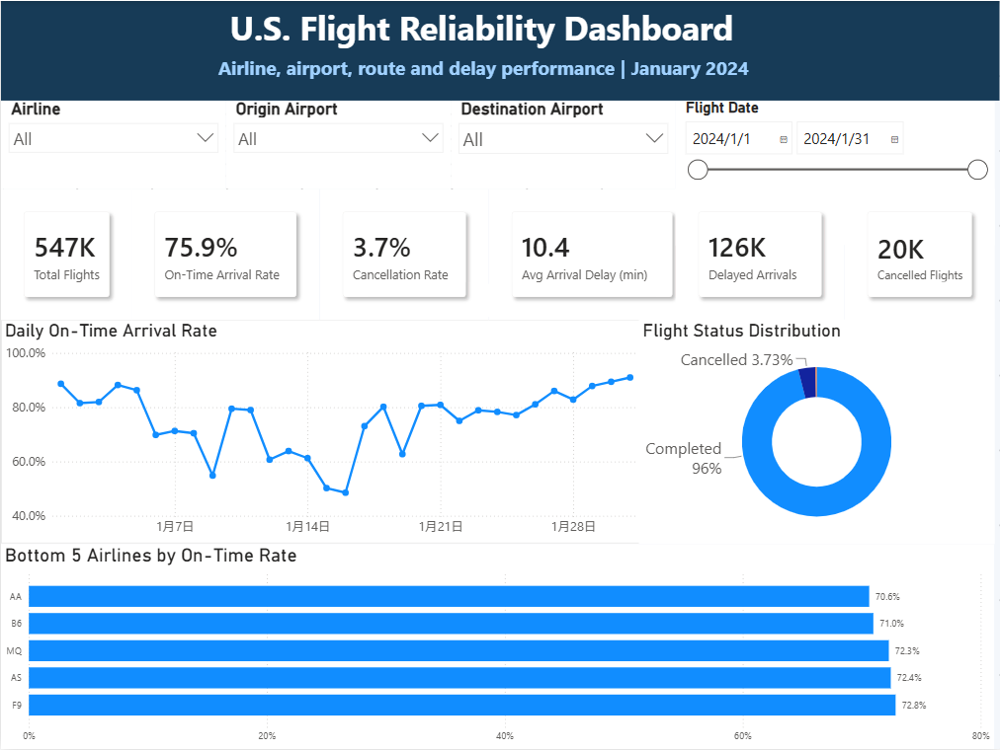
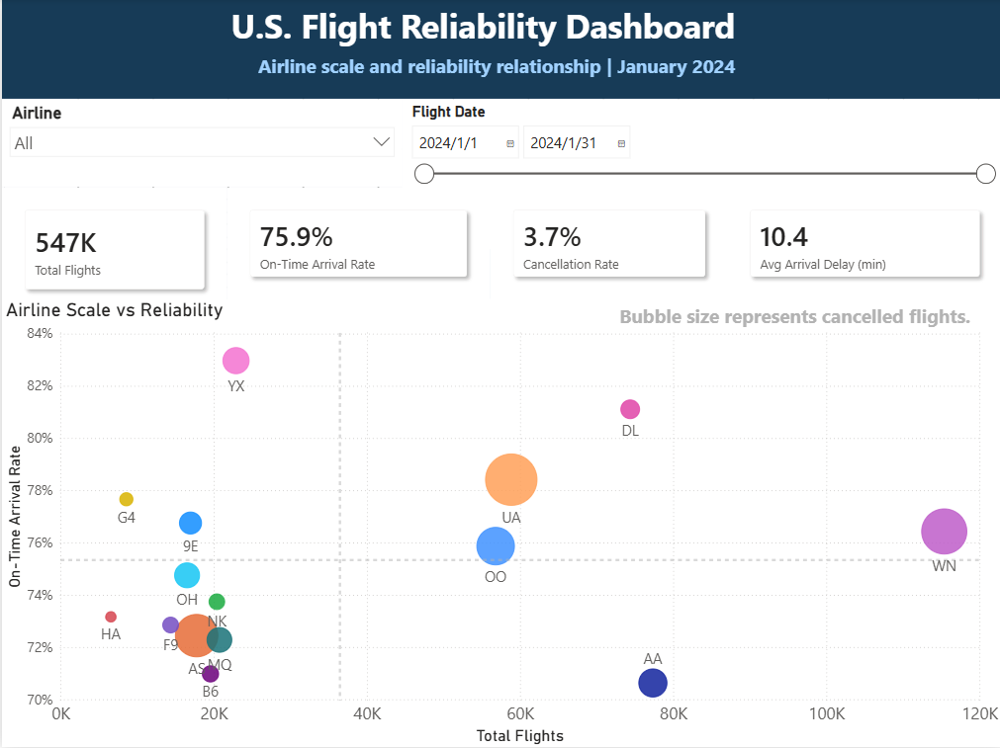
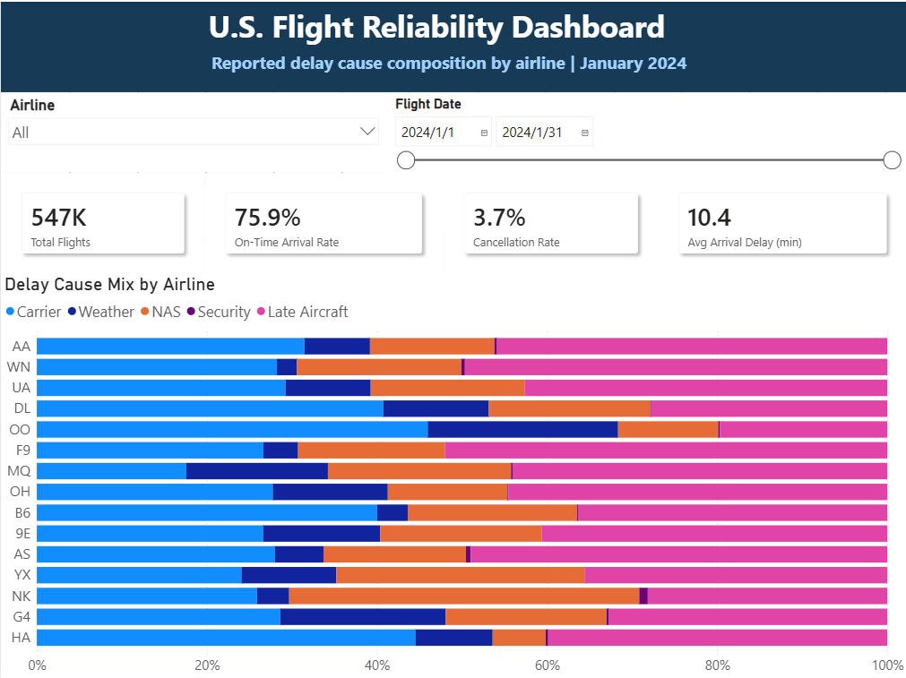
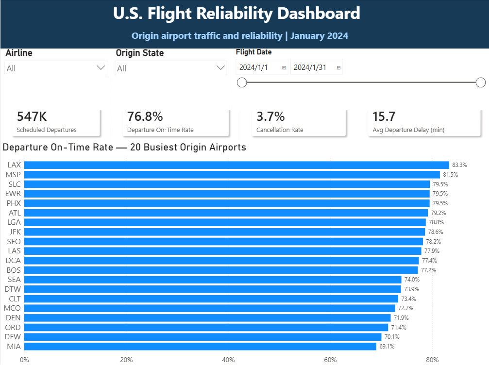
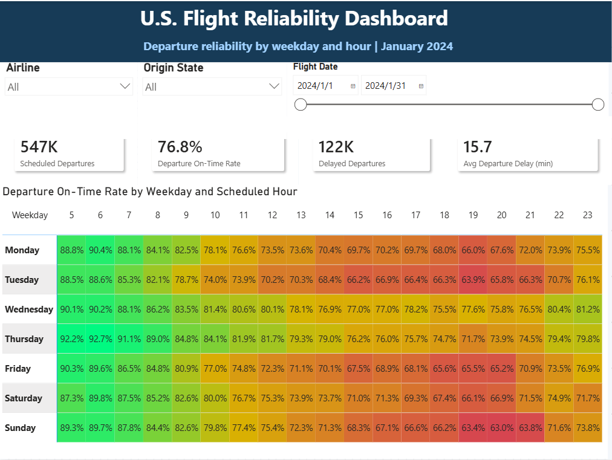

# U.S. Flight Reliability Analytics

**Python ETL · PostgreSQL Data Warehouse · SQL Analytics · Power BI**


## Project Overview

Flight delays and cancellations are major challenges in the aviation industry. They affect passenger satisfaction, airline operations, airport efficiency, and overall travel reliability.

The **U.S. Flight Reliability Analytics** project analyzes flight performance data from the U.S. Bureau of Transportation Statistics (BTS).

The project implements an end-to-end ETL pipeline that extracts raw flight data, validates and cleans it using Python, stores the processed data in Parquet format, loads it into a PostgreSQL data warehouse, and generates analytical reports using Power BI.

The main objective is to identify flight delay patterns, compare airline performance, analyze airport and route reliability, and understand the major causes of delays.

## What I Built

For this project, I used the January 2024 flight dataset containing **547,271 scheduled flight segments**, covering 15 reporting airlines and 334 airports.

I implemented a complete data processing workflow, starting from raw CSV data and ending with interactive Power BI dashboards.

### ETL Pipeline

```text
BTS Raw CSV Dataset
        |
        v
Raw Data Profiling
        |
        v
Raw Data Validation
        |
        v
Python Data Cleaning
        |
        v
Data Transformation
        |
        v
Snappy Compressed Parquet
        |
        v
Clean Data Validation
        |
        v
PostgreSQL Data Warehouse
        |
        v
Dimension Table Loading
        |
        v
Fact Table Loading
        |
        v
Warehouse Validation
        |
        v
SQL Analytics Views
        |
        v
Power BI Dashboard
```

## Project Results

The following results were obtained from the January 2024 pilot dataset.

| Metric | Result |
|---|---:|
| Scheduled Flights | 547,271 |
| Completed Flights | 525,370 |
| Cancelled Flights | 20,389 |
| Diverted Flights | 1,512 |
| Reporting Airlines | 15 |
| Airports | 334 |
| Arrival On-Time Rate | 75.9% |
| Departure On-Time Rate | 76.8% |
| Cancellation Rate | 3.7% |
| Delayed Arrivals | 126,410 |
| Delayed Departures | 122,259 |
| Average Arrival Delay | 10.4 minutes |
| Average Departure Delay | 15.7 minutes |
| Original CSV Size | Approximately 141 MB |
| Cleaned Parquet Size | Approximately 19.76 MB |

### Data Compression Result

The cleaned Parquet file is approximately **86% smaller** than the original CSV file.

This reduces storage requirements and makes the processed data more efficient to work with.

## Technologies Used

| Technology | Purpose |
|---|---|
| Python 3.11 | ETL pipeline development |
| Pandas | Data cleaning and transformation |
| PyArrow | Parquet processing and compression |
| PostgreSQL 18 | Data warehouse |
| SQL | Data analysis and analytical views |
| Power BI | Interactive dashboard development |
| DAX | Measures and calculations |
| Docker Compose | Local PostgreSQL setup |
| pytest | Automated testing |
| GitHub Actions | Continuous integration |

## Data Warehouse Architecture

The project uses a **Star Schema** to organize flight information for analytical queries.

### Fact Table

`warehouse.fact_flight`

Stores the main flight-related measurements and details:

- Scheduled and actual departure times.
- Scheduled and actual arrival times.
- Departure and arrival delay minutes.
- Flight distance and taxi time.
- Cancellation and diversion status.
- Reported delay causes.
- Route information.

### Dimension Tables

**1. dim_date**
- Calendar date.
- Year, month, day, and weekday information.

**2. dim_airline**
- Airline identifier.
- Reporting carrier code.

**3. dim_airport**
- Airport identifier.
- Airport code.
- City and state information.

The airport dimension is reused for both origin and destination airports.

### Star Schema Relationship

```text
             dim_date
                |
                |
dim_airline -- fact_flight -- dim_airport
                |
                |
           Flight Records
```

The grain of the fact table is **one row per scheduled flight segment**.

## Power BI Dashboard

The PostgreSQL warehouse is connected to Power BI to create interactive reports and visualizations.

The dashboard focuses on the following areas:

1. **Executive Overview** – Total flights, delays, cancellations, and overall reliability.
2. **Airline Performance** – Comparison of airline reliability and average delays.
3. **Airline Comparison** – Flight volume and performance comparison.
4. **Scale vs Reliability** – Relationship between airline traffic volume and reliability.
5. **Delay Cause Analysis** – Carrier, weather, NAS, security, and late-aircraft delays.
6. **Airport Ranking** – Airport performance and delay comparisons.
7. **Route Reliability** – Flight volume and delay patterns across routes.
8. **Departure Time Patterns** – Delay variations based on departure time.

### Dashboard Screenshots

Add your actual dashboard screenshots in the `docs/images/dashboard/` folder and use the following references.

**Executive Overview**



**Airline Performance**



**Delay Cause Analysis**



**Airport Ranking**



**Departure Time Patterns**



## Key Business Questions

The project helps answer the following questions:

- How many flights arrive and depart on time?
- Which airlines have the highest and lowest average delays?
- Which airports experience higher departure delays?
- Which routes have higher flight volumes and delay risks?
- How do flight delays vary throughout the day?
- What are the major reported causes of flight delays?
- What percentage of flights are cancelled or diverted?

## Data Validation and Quality Checks

Data validation is performed at three stages of the pipeline.

### 1. Raw Data Validation
- Checks required source columns.
- Validates flight dates.
- Checks missing and duplicate records.
- Validates cancellation and diversion indicators.
- Checks scheduled flight information.

### 2. Cleaned Data Validation
- Checks required values and data types.
- Validates date and time fields.
- Checks delay calculations.
- Validates flight status.
- Checks duplicate flight records.
- Validates the cleaned Parquet output.

### 3. PostgreSQL Warehouse Validation
- Reconciles source and warehouse record counts.
- Checks flight status counts.
- Validates dimension records.
- Checks foreign-key relationships.
- Verifies flight uniqueness and reported delay values.

These checks help maintain data consistency throughout the ETL process.

## SQL Analytics

SQL views are created in the analytics schema to support reporting and analysis.

The project includes analytical views for:

- Flight details.
- Overall flight metrics.
- Daily performance.
- Airline performance.
- Origin airport performance.
- Route performance.
- Departure-hour performance.
- Delay causes by airline.

These views provide reusable data for Power BI dashboards.

## Data Source

**U.S. Department of Transportation – Bureau of Transportation Statistics (BTS)**

Dataset: Reporting Carrier On-Time Performance.

Source: https://www.transtats.bts.gov/

The current pipeline is built around the January 2024 dataset. Raw and processed datasets are excluded from the GitHub repository because of their size.

Expected raw dataset location:

```text
data/raw/flights_2024_01.csv
```

## Project Structure

```text
flight-reliability-analytics/
│
├── src/
│   ├── contracts.py
│   ├── database.py
│   ├── transform/
│   │   └── clean_flight_data.py
│   ├── load/
│   │   ├── load_warehouse.py
│   │   └── test_database_connection.py
│   └── validation/
│
├── sql/
│   ├── schema/
│   └── analytics/
│
├── data/
│   ├── raw/
│   ├── processed/
│   └── interim/
│
├── tests/
├── docs/
│   └── images/
│       └── dashboard/
│
├── powerbi/
├── requirements.txt
├── .env.example
├── .gitignore
└── README.md
```

*Note: This is the intended structure. Keep only the folders and files that are actually present in your uploaded repository.*

## How to Run the Project

### 1. Clone the Repository

```bash
git clone YOUR_GITHUB_REPOSITORY_URL
cd flight-reliability-analytics
```

### 2. Create a Python Environment

```powershell
py -3.11 -m venv .venv
.venv\Scripts\Activate.ps1
```

### 3. Install Dependencies

```bash
pip install -r requirements.txt
```

### 4. Configure Database

Create a local `.env` file using the provided `.env.example` template and configure your PostgreSQL connection details.

Do not upload your actual `.env` file or database password to GitHub.

### 5. Add the Dataset

Place the January 2024 BTS CSV file inside:

```text
data/raw/flights_2024_01.csv
```

### 6. Run the ETL Pipeline

Run the cleaning and transformation script:

```bash
python src/transform/clean_flight_data.py
```

Then load the processed data into the PostgreSQL warehouse:

```bash
python src/load/load_warehouse.py
```

### 7. Connect Power BI

Connect Power BI to the PostgreSQL database and use the analytics views to create reports.

*Note: These are the main pipeline commands. Follow the project's actual database configuration and validation scripts when setting up a fresh environment.*

## Challenges and Improvements

During development, I worked on:

- Handling missing and invalid flight data.
- Standardizing source column names.
- Converting scheduled flight times into valid time formats.
- Reducing storage size using Parquet compression.
- Resolving database loading and column mapping issues.
- Designing fact and dimension tables.
- Maintaining consistency between source data and warehouse records.

## Future Enhancements

The project can be extended with:

1. Automated monthly flight data ingestion.
2. Incremental data loading.
3. Additional airline and airport reference information.
4. Airport location and time-zone integration.
5. dbt models and additional data quality tests.
6. Cloud deployment using AWS or Azure.
7. Predictive analytics for estimating flight delays.

These are planned improvements and are not part of the current implementation.

## Learning Outcomes

Through this project, I gained practical experience in:

- Building an end-to-end ETL pipeline.
- Cleaning and transforming large datasets using Python.
- Working with Parquet files and compression.
- Designing a star-schema data warehouse.
- Writing SQL queries and analytical views.
- Connecting PostgreSQL with Power BI.
- Creating interactive data visualizations.
- Understanding data validation and quality checks.

## Author

**Shreyas Kini**

Computer Science Engineering Student

GitHub: https://github.com/shreyas18-hub/flight-reliability-analytics.git

## License

This project is intended for educational and portfolio purposes.

## Data Acknowledgement

Flight performance data is sourced from the U.S. Department of Transportation Bureau of Transportation Statistics. This is an independent student project and is not affiliated with the department.